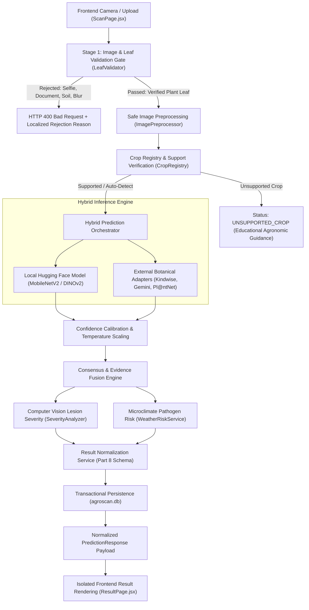
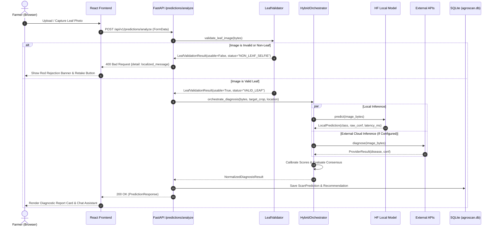

# AgroScan AI — Hybrid Intelligence Engine Architecture Specification
**Document:** System Architecture & Component Blueprint  
**Target:** Local-First Hybrid Plant-Health Intelligence Platform  

---

## 1. System Overview & Philosophy

AgroScan AI is designed as a **modular, local-first, hybrid intelligence engine** for agricultural disease diagnosis and crop health monitoring. The system operates on three foundational principles:
1. **Zero Fabrication:** The system never synthesizes, fabricates, or guesses disease diagnoses. If an image is invalid, a crop is unsupported, or models disagree, the engine transparently reports this condition.
2. **Local-First Execution:** Visual deep learning inference is executed locally using Hugging Face models running on CPU/GPU without mandatory cloud dependencies.
3. **Calibrated Hybrid Fusion:** Local model predictions and external botanical APIs are integrated through calibrated decision logic, uncertainty quantification, and consensus scoring.



---

## 2. Core Architectural Components

The architecture is partitioned into 11 independently testable components located under `backend/app/services/ai/` and connected cleanly to existing services:

```
backend/app/services/
├── ai/
│   ├── __init__.py
│   ├── image_preprocessor.py       # Component A: Safe decoding, dimension checks, tensor prep
│   ├── leaf_validator_adapter.py    # Component B: Integration with LeafValidator
│   ├── hf_inference_service.py     # Component C: Genuine Hugging Face PyTorch inference
│   ├── model_registry.py           # Component F: Lazy loading, caching, device detection, health
│   ├── crop_registry.py            # Component E: Crop taxonomy, support status, alias lookup
│   ├── confidence_calibrator.py    # Component H: Temperature scaling, thresholding, uncertainty
│   ├── orchestrator.py             # Component G: 10-step hybrid orchestrator
│   └── result_normalizer.py        # Component I: Standard Part 8 response normalization
├── providers/                      # Component D: External API adapters (Kindwise, Gemini, etc.)
├── leaf_validator.py               # Existing Component B core: CV quality & non-leaf filters
├── severity_analyzer.py            # Existing lesion segmentation
└── weather_service.py              # Existing microclimate pathogen risk engine
```

### Component A: Image Preprocessing Service (`image_preprocessor.py`)
- **Responsibilities:**
  - Verifies image byte headers and enforces strict file size boundaries ($\le 10$ MB).
  - Enforces pixel dimension limits ($100 \times 100$ px minimum, $4096 \times 4096$ px maximum) to prevent decompression bombs (`PIL.Image.DecompressionBombError`).
  - Converts diverse image formats (JPEG, PNG, WebP) to normalized 3-channel RGB.
  - Generates preprocessed PyTorch tensors with standard ImageNet normalization ($\mu = [0.485, 0.456, 0.406]$, $\sigma = [0.229, 0.224, 0.225]$) and $224 \times 224$ px dimensions for local models.
  - Implements safe in-memory buffer handling with zero disk clutter.

### Component B: Leaf Image Validation Service (`leaf_validator.py`)
- **Responsibilities:**
  - Pure NumPy/PIL execution gate requiring no native OpenCV system libraries.
  - Sharpness check via discrete Laplacian convolution ($\text{var} \ge 8.0$).
  - Mean luminance check ($15.0 \le \mu \le 245.0$) and specular reflection check ($< 35\%$).
  - Non-leaf rejection:
    - Human selfies (skin tone in YCbCr/HSV space and Haar cascade).
    - Documents and screenshots (high white page ratio with rectilinear text lines).
    - Buildings and vehicles (high rectilinear orthogonal gradients).
    - Soil and bare mud (elevated brown spectrum with negligible vegetation index).
    - Flowers without leaves (high petal chromaticity with foliage $< 8\%$).
    - Sky and landscapes (high sky blue ratio with foliage $< 8\%$).
  - Botanical vegetation confirmation: Excess Green Index ($\text{ExG} = 2G - R - B \ge 12.0$) and Normalized Difference Vegetation Index ($\text{NDI} \ge 0.04$).

### Component C: Hugging Face Local Inference Service (`hf_inference_service.py`)
- **Responsibilities:**
  - Executes genuine deep learning inference on local hardware using PyTorch and Hugging Face Transformers.
  - Supports `neghani/plantvillage-mobilenetv2` as the ultra-fast default model (~3.5M parameters, <100MB RAM, 20ms CPU latency).
  - Supports `rodynaemad/plant-disease-dinov2-small` as the secondary vision transformer (~22M parameters, 100ms CPU latency).
  - Automatically selects `cuda` if an NVIDIA GPU is available and compatible, otherwise executes efficiently on `cpu`.
  - Enforces execution timeouts (configurable default: 5.0 seconds).
  - Measures and logs exact inference duration.
  - Maps internal model class indices to canonical AgroScan disease and crop entities.

### Component D: External Plant-Disease API Adapters (`providers/`)
- **Standard Interface (`base_provider.py`):**
  - `is_available() -> bool`
  - `diagnose(image_bytes, plant_name, location, language) -> ProviderDiagnosisResult`
  - `get_health_status() -> ProviderHealthStatus`
  - `get_supported_capabilities() -> Dict[str, Any]`
- **Supported Adapters:**
  - **Kindwise / Plant.id Adapter (`kindwise_provider.py`):** Official v3 identification and v2 disease diagnostics.
  - **Google Gemini Vision Adapter (`gemini_vision_provider.py`):** Multimodal zero-shot plant and pathology identification.
  - **OpenRouter Vision Adapter (`openrouter_vision_provider.py`):** Alternative vision LLM provider.
  - **Pl@ntNet Adapter (`plantnet_provider.py`):** Botanical taxonomy identification.
- **Fail-Safe Operation:** External provider timeouts or credential failures never crash the engine. Unconfigured providers are reported as `NOT_CONFIGURED` without mock data generation.

### Component E: Crop Identification and Support Registry (`crop_registry.py`)
- **Taxonomy Management:**
  - Maintains structured profiles for all major crops: identifier, common names, scientific names, aliases, supported local models, supported external APIs, and known diagnostic limitations.
- **Four Explicit Support Statuses:**
  1. `SUPPORTED`: Model weights and validation data exist for both crop identification and pathogen diagnosis (e.g., Tomato, Potato, Apple, Corn, Grape, Soybean).
  2. `PARTIALLY_SUPPORTED`: Crop species is identified and external APIs or general symptoms are recognized, but fine-grained local model classes are limited (e.g., Mango, Cotton, Sugarcane, Chilli, Rice, Wheat).
  3. `UNSUPPORTED`: Crop is recognized in the botanical catalog, but reliable machine learning diagnostic models are not yet calibrated for this species.
  4. `UNKNOWN_CROP`: Uploaded leaf cannot be reliably matched to any recognized agricultural crop.

### Component F: Model Registry (`model_registry.py`)
- **Responsibilities:**
  - Lazy loading: Models are loaded into memory on first scan request, not at server startup.
  - Local caching: Model weights are downloaded once from Hugging Face Hub into `backend/models_cache` (configured via `MODEL_CACHE_DIR`) and reused indefinitely.
  - Memory management: Prevents redundant model copies in RAM.
  - Model health monitoring: Returns loaded status, device (`cpu` / `cuda`), memory usage, and inference latency statistics.

### Component G: Hybrid Prediction Orchestrator (`orchestrator.py`)
- **10-Step Workflow:**
  1. Receive unique scan request (`file`, `farm_id`, `target_crop`, `weather_context`).
  2. Perform Stage 1 leaf and image suitability validation (`LeafValidator`).
  3. Reject invalid or poor-quality images immediately with localized feedback (`HTTP 400`).
  4. Identify crop species via user context, crop registry, or botanical analysis.
  5. Check crop support status in `CropRegistry`.
  6. Execute eligible local models and available external providers with configurable timeouts.
  7. Normalize individual prediction outputs into unified candidates.
  8. Calibrate confidence scores using temperature scaling and model-specific thresholds.
  9. Evaluate agreement across local and external sources.
  10. Assemble and return structured, evidence-backed diagnostic result.
- **Supported Diagnostic Outcomes:**
  - `HEALTHY`: High-confidence assessment of healthy foliage with no pathogenic lesions.
  - `DISEASE_DETECTED`: Clear identification of a specific pathogen with verified symptoms.
  - `UNCERTAIN`: Conflicting model predictions or confidence scores below reliable threshold.
  - `UNSUPPORTED_CROP`: Crop is recognized, but no calibrated disease model is available.
  - `INVALID_IMAGE`: Non-leaf image rejected at Stage 1.
  - `POOR_IMAGE_QUALITY`: Blurry, underexposed, or washed-out photograph.
  - `PROVIDER_UNAVAILABLE`: All configured external AI providers timed out or reported errors.
  - `ANALYSIS_FAILED`: Unrecoverable runtime error during image decoding or inference.

### Component H: Confidence Calibration & Uncertainty Handler (`confidence_calibrator.py`)
- **Temperature Scaling:** Applies calibrated temperature $T = 0.8845$ to soften raw neural network logits before softmax:
  $$\hat{p}_i = \frac{\exp(z_i / T)}{\sum_j \exp(z_j / T)}$$
- **Decision Thresholds:**
  - High confidence: Calibrated score $\ge 0.70$.
  - Moderate confidence: Calibrated score in $[0.50, 0.70)$.
  - Low confidence / Uncertain: Calibrated score $< 0.50$.
- **Disagreement Rule:** When local and external models predict different diseases, the orchestrator flags the result as `LOW_CONFLICTING` or `UNCERTAIN`, presents both possibilities to the farmer, and advises physical field verification.

### Component I: Diagnosis Result Normalization Service (`result_normalizer.py`)
- Standardizes all engine outputs into the comprehensive Part 8 schema with explicit, evidence-based agronomic guidance, pre-harvest intervals, organic alternatives, and mandatory extension disclaimers.

### Component J: Scan History & Data Isolation
- Enforces strict user-level access controls in SQLite:
  - Authenticated farmers can only read, list, and delete scans where `user_id == current_user.id`.
  - Guest scans are assigned unique random session IDs and isolated from authenticated farm plots.
  - `DELETE /api/v1/predictions/{id}` strictly enforces record ownership.

### Component K: Logging and Monitoring
- Structured Python logging with execution latencies, model inference times, provider statuses, and error codes without leaking API credentials or personal identifiable information.

---

## 3. Data Flow and Sequence


