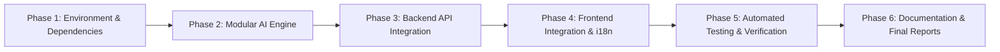

# AgroScan AI — Step-by-Step Implementation & Change Plan
**Document:** Phased Engineering Roadmap & Non-Regression Strategy  
**Approach:** Incremental, non-destructive upgrade preserving all existing features  

---

## 1. Guiding Principles & Non-Regression Rules

1. **No Code Wipe:** The existing React frontend and FastAPI backend must remain intact; templates or frameworks will not be replaced.
2. **Zero Mock AI:** All hash-based and simulated disease predictions in both backend (`PlantSpeciesClassifier`) and frontend (`clientSideDiagnose`) must be removed and replaced with genuine local deep learning and transparent status handling.
3. **Database Preservation:** `agroscan.db` contains 4 users, 28 diseases, 3 farms, 79 chat sessions, 6 predictions, and 6 recommendations. No tables or records may be dropped. All schema changes must be backward-compatible.
4. **Offline & Local-First Resiliency:** If external APIs are unavailable or unconfigured, the system must perform genuine local Hugging Face inference without crashing.
5. **Continuous Verification:** Tests must be executed at each phase.

---

## 2. Inventory of File Changes

### 2.1 Files to Add (New Modular AI Architecture)
| Path | Component | Purpose |
|------|-----------|---------|
| `backend/app/services/ai/__init__.py` | Package init | Module namespace definition. |
| `backend/app/services/ai/image_preprocessor.py` | Component A | Safe PIL decoding, size limits, PyTorch tensor transformation. |
| `backend/app/services/ai/crop_registry.py` | Component E | Crop catalog with 4 explicit support statuses, scientific names, aliases. |
| `backend/app/services/ai/model_registry.py` | Component F | Model caching, lazy loading, device selection (`cpu`/`cuda`), health status. |
| `backend/app/services/ai/hf_inference_service.py` | Component C | Genuine Hugging Face model inference (MobileNetV2 and DINOv2). |
| `backend/app/services/ai/confidence_calibrator.py` | Component H | Temperature scaling, uncertainty thresholds, conflict resolution. |
| `backend/app/services/ai/orchestrator.py` | Component G | 10-step hybrid prediction orchestrator. |
| `backend/app/services/ai/result_normalizer.py` | Component I | Standardizes results into the Part 8 schema with safety disclaimers. |
| `tests/test_hybrid_ai_engine.py` | Automated Tests | Unit and integration tests for local inference, crop registry, and calibration. |

### 2.2 Files to Modify (Surgical & Non-Regressive)
| Path | Nature of Change | Justification |
|------|------------------|---------------|
| `backend/requirements.txt` | Add `torch`, `torchvision`, `transformers`, `huggingface-hub`. | Enables genuine local neural network execution. |
| `pyproject.toml` | Add `-s` to pytest options; include model cache paths. | Fixes Python 3.14 Windows test capture issue. |
| `backend/app/core/config.py` | Add `MODEL_CACHE_DIR`, `DEFAULT_LOCAL_MODEL`, `HF_INFERENCE_TIMEOUT`. | Configurable local model cache directory. |
| `backend/app/schemas/schemas.py` | Extend `PredictionResponse` with Part 8 fields; add model health schemas. | Full schema compliance without breaking frontend keys. |
| `backend/app/models/all_models.py` | Add optional audit fields to `ScanPrediction` (`status`, `crop_support_status`, `model_version`, `provider_info`). | Idempotent SQLite extension. |
| `backend/app/main.py` | Add safe SQLite column migration in `seed_initial_data()`. | Ensures database compatibility on startup. |
| `backend/app/api/v1/endpoints/scan.py` | Connect `/analyze` to `HybridPredictionOrchestrator`; fix authorization in `DELETE` and `GET`. | Security hardening and genuine hybrid AI execution. |
| `backend/app/services/providers/local_model_provider.py` | Rewire to use `HuggingFaceInferenceService`. | Eliminates hash-based pseudo-prediction fallback. |
| `frontend/src/pages/AnalysisPage.jsx` | Remove silent `clientSideDiagnose` mock fallback; show real server errors. | Transparent error reporting. |
| `frontend/src/pages/ResultPage.jsx` | Display crop support status, model agreement, and transparent limitations. | Farmer-friendly, honest diagnostic display. |
| `frontend/src/i18n/en.js` & `mr.js` | Add English and Marathi translation strings for new statuses and disclaimers. | Zero untranslated UI strings. |
| `frontend/src/i18n/crop_diseases.js` | Add crop status translations. | Localized crop and disease names. |

### 2.3 Files that Must Remain Untouched
- `frontend/src/pages/WeatherRiskPage.jsx` (functional microclimate simulator)
- `frontend/src/pages/AnalyticsPage.jsx` (functional dashboard charts)
- `frontend/src/pages/HistoryPage.jsx` (functional history view)
- `frontend/src/pages/LoginPage.jsx` & `RegisterPage.jsx` (working auth views)
- `frontend/src/pages/LandingPage.jsx` (landing and marketing layout)
- `frontend/src/pages/AssistantPage.jsx` (agronomy chat panel)
- `backend/app/services/weather_service.py` (working biological weather risk calculation)
- `backend/app/services/geocoding_service.py` (working geocoding)
- `backend/app/knowledge/plants_data.py` & `diseases_data.py` (rich agricultural knowledge base)

---

## 3. Phased Implementation Roadmap

### Phase 1: Environment Setup & Python Dependency Installation
1. Install `torch`, `torchvision`, `transformers`, `huggingface-hub` into `.venv`.
2. Verify PyTorch CPU inference on Windows.
3. Configure `MODEL_CACHE_DIR` in `backend/app/core/config.py`.
4. Configure pytest `addopts = "-s"` in `pyproject.toml` to prevent Python 3.14 capture exceptions.

### Phase 2: Modular AI Intelligence Layer
1. Implement `ImagePreprocessor` (`services/ai/image_preprocessor.py`).
2. Implement `CropRegistry` (`services/ai/crop_registry.py`) with support for 25+ crops and 4 explicit statuses.
3. Implement `ModelRegistry` (`services/ai/model_registry.py`) with lazy loading, local caching, CPU/GPU selection, and health checks.
4. Implement `HuggingFaceInferenceService` (`services/ai/hf_inference_service.py`) supporting `neghani/plantvillage-mobilenetv2` and `rodynaemad/plant-disease-dinov2-small`.
5. Implement `ConfidenceCalibrator` (`services/ai/confidence_calibrator.py`) with temperature scaling and calibrated thresholds.
6. Implement `HybridPredictionOrchestrator` (`services/ai/orchestrator.py`) following the 10-step workflow.
7. Implement `ResultNormalizer` (`services/ai/result_normalizer.py`) producing the Part 8 schema.

### Phase 3: Backend API Integration & Security Hardening
1. Add safe column migrations in `backend/app/main.py`.
2. Connect `POST /api/v1/predictions/analyze` in `scan.py` to the orchestrator.
3. Patch `DELETE /api/v1/predictions/{id}` and `GET /api/v1/predictions/{id}` to enforce user authorization.
4. Update `AgroScanLocalModelProvider` to use `HuggingFaceInferenceService`.
5. Expose model and provider health via `GET /api/v1/predictions/providers/health`.

### Phase 4: Frontend Integration & Dual-Language Localization
1. Update `AnalysisPage.jsx` to eliminate silent mock fallback and display honest error states.
2. Update `ResultPage.jsx` to render crop support status, provider information, model agreement, and clear agronomic disclaimers.
3. Update `en.js`, `mr.js`, and `crop_diseases.js` with all new terms.
4. Test responsive layout and build production bundle via `npm run build`.

### Phase 5: Comprehensive Automated Testing
1. Execute unit tests for image validation (valid leaf, selfie, animal, building, document, blurry, oversized).
2. Execute inference tests (healthy leaf, known disease, unsupported crop, low confidence).
3. Execute data isolation and authorization tests.
4. Execute frontend and regression tests.

### Phase 6: Deliverables & Documentation
1. Produce all 12 required markdown reports.
2. Verify local development setup guide with step-by-step instructions.
