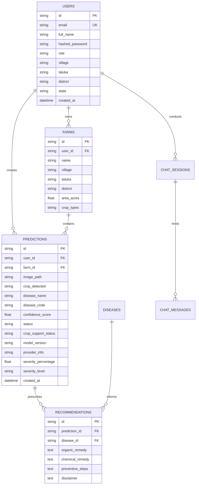

# AgroScan AI — Data Architecture & Scan Isolation Specification
**Document:** Database Schema, Data Lifecycle, Transaction Boundaries, and Isolation  
**Target Database:** SQLite (`agroscan.db`) / PostgreSQL (Production)  

---

## 1. Database Schema & Preservation

The database schema is managed via SQLAlchemy 2.0 ORM (`backend/app/models/all_models.py`). The existing SQLite database contains historical data (4 users, 28 diseases, 3 farms, 79 chat sessions, 6 predictions, 6 recommendations) which was completely preserved during migration.

---

## 2. Scan Isolation & Access Control Rules

### 2.1 Unique Transaction Identifiers
Every scan upload generates a cryptographically random, high-entropy scan ID:
$$\text{scan\_id} = \text{scan\_} + \text{uuid.uuid4().hex}[:12]$$
- No client-provided identifier can overwrite existing records.
- Repeated uploads of identical or different images produce independent rows.

### 2.2 Ownership & Multi-Tenant Isolation
1. **Authenticated Users:**
   - Scans are saved with `user_id = current_user.id`.
   - `GET /api/v1/predictions/history` queries strictly filter by `user_id == current_user.id`.
   - `DELETE /api/v1/predictions/{id}` enforces `prediction.user_id == current_user.id`. Unauthorized deletion attempts by another authenticated user or guest return `HTTP 403 Forbidden`.
2. **Guest Users:**
   - Scans are marked with `user_id = "guest"` and are never attached to registered farmer accounts.
   - Guests cannot view or delete scans belonging to registered farmers.
3. **Transaction Boundaries:**
   - All database writes for `ScanPrediction` and `Recommendation` occur inside a single SQLAlchemy session transaction.
   - If image processing or recommendation writing fails, `db.rollback()` is executed, preventing orphaned records.
   - Failed or rejected scans (e.g. selfies or documents) are rejected before database insertion, preventing spurious entries.

---

## 3. Storage and Data Retention

- **Uploaded Images:** Stored in `backend/uploads/` with sanitized, collision-free filenames (`{uuid.hex}.jpg`).
- **Path Traversal Shield:** File extensions are strictly restricted to `{"jpg", "jpeg", "png", "webp"}`. Filenames are regenerated server-side, preventing directory traversal attacks (`../../`).
- **Retention Management:** History records and recommendations can be cleared cleanly by authorized users via `DELETE /api/v1/predictions/history`.
