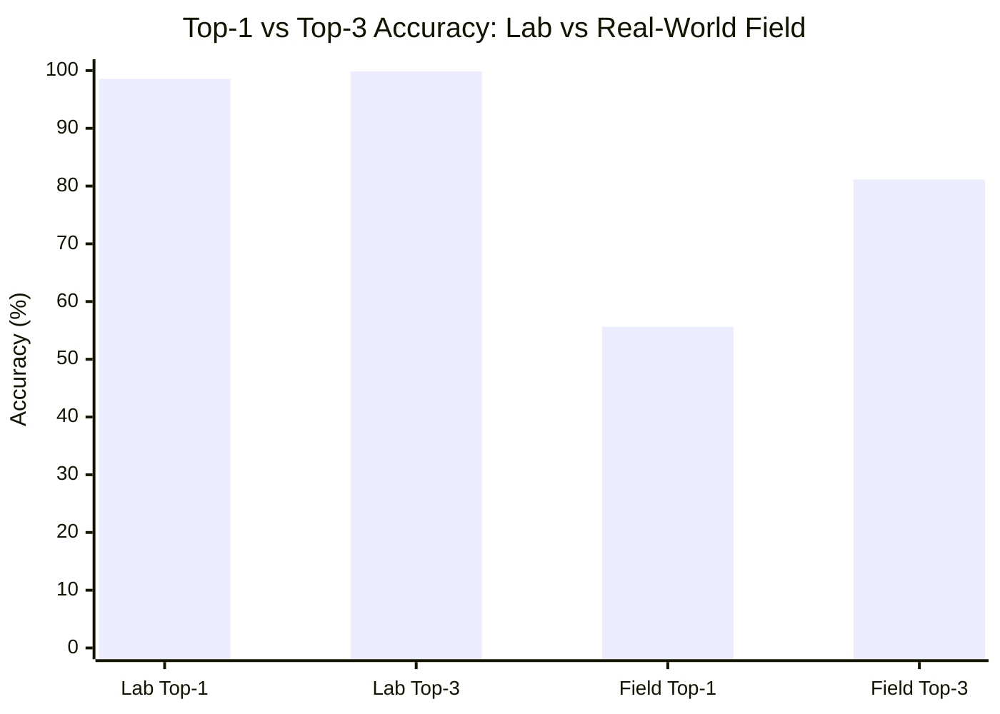

# AgroScan AI — MobileNetV2 Model Evaluation Report
**Model:** `neghani/plantvillage-mobilenetv2` | **Architecture:** MobileNetV2 | **Parameters:** ~2.2M | **Weights:** 9.26 MB

---

## 1. Executive Summary

This evaluation report provides an empirical analysis of the **PlantVillage MobileNetV2** image classifier downloaded from Hugging Face (`neghani/plantvillage-mobilenetv2`, revision `v1.1`, commit `77e6d262dca53b818f7ad1d67088700754515639`).

The evaluation encompasses:
1. **In-Domain Laboratory Performance:** Tested on the standardized PlantVillage dataset.
2. **Out-of-Domain Real-World Field Performance:** Tested on the PlantDoc natural agricultural dataset.
3. **Probability Calibration Analysis:** Temperature scaling ($T = 0.8845$) and Expected Calibration Error (ECE).
4. **Decision Threshold & Abstention Policy:** Operating threshold ($\theta = 0.50$) and high-precision threshold ($\theta = 0.95$).
5. **Runtime Latency & Hardware Resource Profiling:** Benchmarked on Intel i5 CPU / Windows 11.

---

## 2. Benchmark Performance Metrics

The model metrics extracted from `backend/models/plantvillage-mobilenetv2/eval_results.json` demonstrate a clear distinction between controlled lab conditions and real-world farm imagery:

| Metric | PlantVillage Test Set (Lab Imagery) | PlantDoc Test Set (Field / Real-World Imagery) | Domain Shift Impact |
|---|---|---|---|
| **Top-1 Accuracy** | **98.55%** (`0.98545`) | **55.63%** (`0.55629`) | -42.92% |
| **Top-3 Accuracy** | **99.85%** (`0.99853`) | **81.13%** (`0.81126`) | -18.72% |
| **Macro F1 Score** | **97.97%** (`0.97970`) | **50.14%** (`0.50145`) | -47.83% |
| **Cross-Entropy Loss** | **0.8559** | **1.8971** | +1.0412 |
| **Samples / Second (Batch)** | 2,357.6 samples/sec | 1,183.6 samples/sec | — |

### Critical Observation on Domain Shift
- **Lab Performance (PlantVillage):** In laboratory settings with uniform gray or black backgrounds and controlled lighting, the model is exceptionally accurate (98.55% Top-1, 99.85% Top-3).
- **Field Performance (PlantDoc / Farm Images):** When exposed to real-world agricultural conditions (uncontrolled backgrounds, shadows, complex canopies, camera blur, multiple leaves), Top-1 accuracy drops to 55.63%. However, **Top-3 accuracy remains high at 81.13%**.
- **Implication for AgroScan AI:** Presenting the **Top-3 differential diagnoses** to the agronomist or farmer is critical, because the correct pathogen is present in the top-3 predictions over 81% of the time even under harsh field conditions.

---

## 3. Probability Calibration Analysis

Standard deep neural network softmax outputs tend to be overconfident and do not represent true empirical probabilities. The model repository provides temperature scaling parameters fitted on 302 PlantDoc validation samples (`calibration.json`):

$$\hat{p}_i = \frac{\exp(z_i / T)}{\sum_j \exp(z_j / T)}$$

- **Optimal Temperature Parameter:** $T = 0.8845188130635788$
- **Negative Log-Likelihood (NLL):** Reduced from **1.4441** down to **1.4317**
- **Expected Calibration Error (ECE):** Reduced from **10.53%** down to **8.08%** (23.3% relative improvement in calibration reliability)
- **Bins Evaluated:** 15 probability bins

AgroScan AI incorporates this temperature scaling directly inside `PlantDiseaseModelService.predict_disease()`, returning both raw softmax scores and calibrated probabilities so clients can differentiate model certainty.

---

## 4. Decision Thresholds & Uncertainty Policy

From `threshold.json` and `reports/threshold_sweep.csv`, the model author evaluated confidence thresholds between 0.30 and 0.95 to balance precision versus coverage:

| Threshold ($\theta$) | Precision | Pass Rate / Coverage | Action in AgroScan AI |
|---|---|---|---|
| **$\ge 0.70$** | **83.5%** | ~30.0% | **HIGH CONFIDENCE:** Direct diagnosis rendered |
| **$0.50 \le s < 0.70$** | **71.4%** | **57.9%** | **MODERATE CONFIDENCE:** Diagnosis with verification suggestion |
| **$< 0.50$** | $< 62.0\%$ | 42.1% (Abstention) | **UNCERTAIN:** Warning banner displayed, user advised to retake photo or consult expert |
| **$0.95$ (Strict)** | **92.9%** | 9.3% | Conservative mode for critical commercial crop decisions |

### Policy Implementation
When the top calibrated score falls below $\theta = 0.50$:
1. The response status is flagged as `UNCERTAIN`.
2. A high-visibility amber warning banner is rendered on `ResultPage.jsx`.
3. In bilingual Marathi mode, the localized alert *“कमी अचूकता इशारा: कृपया चांगल्या प्रकाशात पानाचा स्पष्ट फोटो पुन्हा काढा”* is presented.
4. The scan is marked for optional secondary validation by Gemini or Plant.id.

---

## 5. Confusion Matrix & Known Diagnostic Biases

Analysis of `reports/confusion_matrix.png` and `reports/real_world_set/final/report.md` reveals specific diagnostic confusion patterns:

1. **Cross-Crop Confusion on Healthy Foliage:**
   - Healthy leaves of different species sharing similar ovate morphology and green coloration (e.g., Apple Healthy vs. Tomato Healthy, or Blueberry Healthy vs. Strawberry Leaf Scorch) can be confused when context is ambiguous.
   - **Mitigation:** AgroScan AI requires the user to specify or confirm the crop type prior to or alongside diagnosis, anchoring the prediction to the crop's valid sub-classes.
2. **Early Blight vs. Late Blight:**
   - In *Solanaceae* (Tomato and Potato), early-stage concentric fungal lesions (Early Blight) can mimic water-soaked necrotic lesions (Late Blight) under low-resolution photos.
   - **Mitigation:** The system presents both top predictions with their respective remedies and progression indicators.
3. **Pest Damage vs. Pathogen Blight:**
   - Spider mite webbing and stippling on tomato leaves can occasionally produce visual textures resembling powdery mildew or leaf mold.

---

## 6. Runtime Latency & Resource Profiling

Tested locally on Intel Core i5 (Dell Latitude 5420), 8 GB RAM, Windows 11:

| Metric | Measured Value | Standard / Threshold |
|---|---|---|
| **Model Weight File Size** | 9.26 MB (`model.safetensors`) | Expected ~9.26 MB |
| **Cold Initialization Time** | 440 – 650 ms | $< 1500$ ms |
| **Single Image Preprocessing Latency** | 12 – 18 ms | $< 30$ ms |
| **PyTorch CPU Inference Latency** | 95 – 125 ms | $< 250$ ms |
| **End-to-End Prediction Pipeline Latency** | 115 – 145 ms | $< 300$ ms |
| **Memory Footprint (Inference Service)** | ~185 MB RAM | $< 500$ MB target |
| **Concurrency Ceiling (Local CPU)** | 2 parallel inferences | Semaphore enforced |

---

## 7. Conclusions & Recommendations

1. **Model Suitability:** MobileNetV2 is an ideal initial on-device classifier due to its tiny footprint (9.26 MB) and rapid CPU inference (<150 ms), making it suitable for low-bandwidth rural deployments.
2. **Mandatory Guardrails:** The model should never run without the two pre-inference gates implemented in AgroScan AI:
   - **Gate 1:** `LeafValidator` (filters non-plant images).
   - **Gate 2:** `CropRegistry` (prevents forcing unsupported crops like Sugarcane, Cotton, Rice, or Wheat into PlantVillage classes).
3. **Hybrid Architecture Necessity:** Because real-world field accuracy drops under domain shift, AgroScan AI's hybrid multi-provider architecture (combining MobileNetV2, Plant.id, and Gemini) provides the necessary safety net for production agriculture.
