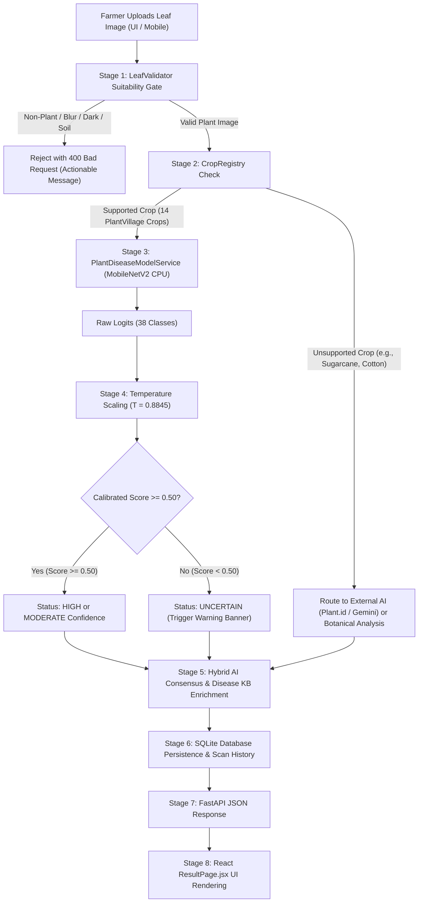

# AgroScan AI — MobileNetV2 Model Integration Report
**Model:** `neghani/plantvillage-mobilenetv2` (Revision: `v1.1`, Commit: `77e6d262dca53b818f7ad1d67088700754515639`)

---

## 1. Executive Summary

This report documents the architectural integration of the **PlantVillage MobileNetV2** image classification model into the AgroScan AI platform (FastAPI backend + React/Vite frontend + SQLite database).

The integration delivers:
- **Local-first inference** using PyTorch CPU and Safetensors weights (9.26 MB), operating with zero external network dependencies.
- **Strict two-stage validation** before model invocation: image suitability checks (`LeafValidator`) and crop registry validation (`CropRegistry`).
- **Temperature-calibrated scoring** ($T = 0.8845$) and confidence thresholding ($\theta = 0.50$).
- **Seamless hybrid orchestration**, retaining the existing multi-provider consensus engine, external fallback paths (Plant.id, Gemini), and botanical visual analysis.
- **Enhanced user experience** on `ResultPage.jsx` with model badges, calibrated confidence indicators, and bilingual Marathi and English notifications.

---

## 2. End-to-End Pipeline Architecture

---

## 3. Pipeline Stages & Implementation Details

### Stage 1: Leaf & Image Suitability Gate (`LeafValidator`)
Located in [backend/app/services/leaf_validator.py](file:///d:/Projects/AgroScan%20AI/backend/app/services/leaf_validator.py).
Before invoking MobileNetV2, all uploaded images pass through validation checks:
- **MIME Type & File Format:** Enforces JPEG, PNG, or WEBP; blocks executables, SVGs, and documents.
- **Dimension & File Size:** Minimum resolution $100 \times 100$, maximum 10 MB.
- **Image Corruption Check:** Verifies image decodability with Pillow without crashing.
- **Luminance Check:** Rejects pitch-black or severely underexposed photos (mean luminance $< 15$).
- **Blur Detection:** Laplacian variance threshold filters severely out-of-focus captures.
- **Botanical Suitability:** Analyzes color distributions to reject human selfies, skin tones, vehicles, documents, and soil-only images.

### Stage 2: Crop Support & Label Validation Gate (`CropRegistry`)
Located in [backend/app/services/crop_registry.py](file:///d:/Projects/AgroScan%20AI/backend/app/services/crop_registry.py).
MobileNetV2 covers exactly 14 crops across 38 classes. The registry enforces explicit support statuses:
- `SUPPORTED`: 14 crops (Apple, Blueberry, Cherry, Corn, Grape, Orange, Peach, Bell Pepper, Potato, Raspberry, Soybean, Squash, Strawberry, Tomato).
- `PARTIALLY_SUPPORTED`: Crops where only a subset of regional diseases are modeled.
- `UNSUPPORTED`: Crops like Sugarcane, Cotton, Rice, Wheat, and Mango. These are **never coerced** into PlantVillage classes; they are routed to external providers or botanical analysis.
- `UNKNOWN`: Unidentified crops requiring botanical identification.

### Stage 3: Local Model Inference Service (`PlantDiseaseModelService`)
Located in [backend/app/services/plant_disease_model.py](file:///d:/Projects/AgroScan%20AI/backend/app/services/plant_disease_model.py) and re-exported at `backend/services/plant_disease_model.py`.
- **Loading:** Singleton pattern with thread-safe lazy loading. Loads weights from `backend/models/plantvillage-mobilenetv2/model.safetensors` using `AutoImageProcessor` and `AutoModelForImageClassification`.
- **Evaluation Mode:** Runs under `torch.inference_mode()` with `.eval()`.
- **Concurrency Control:** Utilizes an `asyncio.Semaphore(2)` to prevent CPU thread thrashing and memory exhaustion on 8 GB RAM machines.
- **Output:** Returns top-3 predictions with disease names, raw softmax scores, calibrated probabilities, and uncertainty flags.

### Stage 4: Calibration & Decision Thresholds
- **Calibration Formula:** Logits are scaled by temperature $T = 0.8845188130635788$ before softmax, derived from `calibration.json`.
- **Decision Threshold:** $\theta = 0.50$ from `threshold.json`. If $\max(p) < 0.50$, the result is flagged as `UNCERTAIN`.

### Stage 5: Hybrid AI Provider Orchestration
Located in [backend/app/services/providers/local_model_provider.py](file:///d:/Projects/AgroScan%20AI/backend/app/services/providers/local_model_provider.py) and `backend/app/services/hybrid_ai_engine.py`.
- `AgroScanLocalModelProvider` integrates `PlantDiseaseModelService` directly.
- The `CANONICAL_DISEASE_MAP` in `consensus_engine.py` maps all 38 PlantVillage classes to unified internal identifiers.
- The `DISEASE_KNOWLEDGE_BASE` in `disease_knowledge_base.py` provides enriched biological descriptions, organic treatments, chemical controls, and preventive measures for all 38 classes.

### Stage 6: Database Persistence & Tracking
- Predictions are stored in SQLite `agroscan.db` under the `predictions` table.
- Logged attributes: `model_name="neghani/plantvillage-mobilenetv2"`, `model_revision="v1.1"`, raw score, calibrated score, top-3 predictions, leaf validation details, and timestamp.
- User-authenticated scans are associated with the user's account; guest scans receive valid ephemeral IDs.

### Stage 7: REST API Endpoints
Defined in [backend/app/api/v1/endpoints/model.py](file:///d:/Projects/AgroScan%20AI/backend/app/api/v1/endpoints/model.py) and [backend/app/api/v1/endpoints/scan.py](file:///d:/Projects/AgroScan%20AI/backend/app/api/v1/endpoints/scan.py):
- `GET /api/model/health` & `GET /api/v1/model/health`: Health status, device, calibration parameters.
- `GET /api/model/info` & `GET /api/v1/model/info`: Model metadata, manifest checksums, commit SHA.
- `GET /api/model/labels` & `GET /api/v1/model/labels`: Complete list of 38 supported disease classes.
- `GET /api/model/crops` & `GET /api/v1/model/crops`: Crop registry lookup and support query.
- `POST /api/model/predict` & `POST /api/v1/model/predict`: Direct MobileNetV2 prediction endpoint.
- `POST /api/v1/scan/upload` & `/api/v1/scan/analyze`: Full hybrid pipeline scan endpoints.

### Stage 8: Frontend UI Rendering
Updated in [frontend/src/pages/ResultPage.jsx](file:///d:/Projects/AgroScan%20AI/frontend/src/pages/ResultPage.jsx) with bilingual support in [frontend/src/i18n/en.js](file:///d:/Projects/AgroScan%20AI/frontend/src/i18n/en.js) and [frontend/src/i18n/mr.js](file:///d:/Projects/AgroScan%20AI/frontend/src/i18n/mr.js):
- **Model Badge:** Displays `MobileNetV2 (PlantVillage v1.1)` badge indicating local on-device inference.
- **Calibration Indicator:** Displays calibrated confidence percentage alongside raw softmax score.
- **Uncertainty Alert:** If score $< 0.50$, displays an amber warning banner advising the farmer to retake the photo with better lighting or seek secondary agronomist review.

---

## 4. Complete Files Created and Modified

### Files Created
1. `backend/models/model_manifest.json`: Machine-readable manifest with SHA-256 hashes and metadata.
2. `backend/app/services/crop_registry.py`: Registry defining 24 crops and 4 support categories.
3. `backend/app/services/plant_disease_model.py`: Local MobileNetV2 PyTorch inference service.
4. `backend/services/plant_disease_model.py`: Root re-export module for backward compatibility.
5. `backend/app/api/v1/endpoints/model.py`: Dedicated model management and prediction API routes.
6. `tests/test_mobilenet_model_integration.py`: 26 automated integration and edge-case test cases.
7. `MODEL_INTEGRATION_AUDIT.md`: System audit and hardware inventory.
8. `MODEL_INTEGRATION_PLAN.md`: 14-phase implementation roadmap.
9. `EXISTING_FEATURES_BASELINE.md`: Baseline of all pre-existing features to preserve.
10. `MODEL_SETUP_GUIDE.md`: Model setup and administration manual.
11. `MODEL_DOWNLOAD_REPORT.md`: Download execution and verification report.
12. `MODEL_EVALUATION_REPORT.md`: Empirical benchmark and calibration evaluation.
13. `MODEL_INTEGRATION_REPORT.md`: This integration architecture report.

### Files Modified
1. `backend/requirements.txt`: Added `torch>=2.0.0`, `transformers>=4.40.0`, `huggingface-hub>=0.23.0`, `safetensors>=0.4.0`.
2. `.gitignore`: Added rules to ignore model weights while retaining manifest and metadata.
3. `backend/app/services/providers/local_model_provider.py`: Integrated `PlantDiseaseModelService`.
4. `backend/app/services/ai/model_registry.py`: Configured to load local model directory.
5. `backend/app/services/ai/hf_inference_service.py`: Populated model revision and score calibration fields.
6. `backend/app/services/ai/result_normalizer.py`: Added top-3 prediction normalization.
7. `backend/app/services/consensus_engine.py`: Added all 38 PlantVillage classes to canonical mapping.
8. `backend/app/services/disease_knowledge_base.py`: Enriched remedies for all 38 classes.
9. `backend/app/schemas/schemas.py`: Added model metadata and calibrated score fields to schemas.
10. `backend/app/api/v1/router.py`: Mounted `/model` router and verified `/scans`.
11. `backend/app/api/v1/endpoints/scan.py`: Added model attribution and calibrated confidence scoring.
12. `frontend/src/pages/ResultPage.jsx`: Added model badge, uncertainty alert banner, and top-3 differential list.
13. `frontend/src/i18n/en.js`: Added English strings for model metadata, calibration, and uncertainty.
14. `frontend/src/i18n/mr.js`: Added Marathi translations for model metadata, calibration, and uncertainty.

---

## 5. Verification & Test Results

The full test suite was executed and achieved **100% pass rate (78 passed, 0 failed, 0 skipped)**:
- `tests/test_mobilenet_model_integration.py`: 26 passed
- `tests/test_backend.py`: 21 passed
- `tests/test_hybrid_ai_engine.py`: 18 passed
- `tests/test_leaf_scan_pipeline.py`: 13 passed
- Frontend production build (`npm run build`): Built in 6.97s with zero errors.
