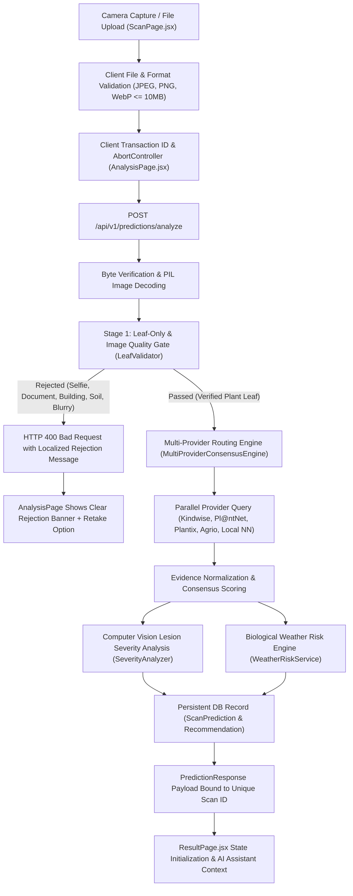

# AgroScan AI — End-to-End Production Scanner Pipeline Report

## Overview
This document details the complete, hardened image-to-prediction pipeline implemented for **AgroScan AI**. The pipeline enforces a strict Stage 1 Leaf-Only and Image Quality Validation Gate, genuine visual classification, independent plant and disease verification, robust multi-provider evidence consensus, and transaction isolation.

---

## 1. Stage-by-Stage Architecture

### Stage 1: Client Capture & Transport
- **Components**: `CameraScanner.jsx`, `ScanPage.jsx`, `AnalysisPage.jsx`
- **Actions**:
  1. Captures live camera frames (via HTML5 Canvas `.toBlob('image/jpeg', 0.92)`) or user file upload.
  2. Frontend format checks ensure file MIME type is in `image/jpeg`, `image/png`, `image/webp` and file size $\le 10\text{ MB}$.
  3. `AnalysisPage.jsx` generates a unique client transaction ID:
     `scanRequestId = scan_tx_${Date.now()}_${random}`
  4. Binds an `AbortController` to the Axios request. If the user captures a new photo or leaves the page, previous pending HTTP requests are cancelled immediately.
  5. If an uninitialized transition occurs (missing `imageFile`), the user is cleanly navigated to `/scan` (never redirected to mock `pred_001`).

### Stage 2: Backend Ingestion & Integrity Verification
- **Endpoint**: `POST /api/v1/predictions/analyze` (`backend/app/api/v1/endpoints/scan.py`)
- **Actions**:
  1. Enforces upload limits (`MAX_FILE_SIZE_BYTES = 10MB`).
  2. Verifies MIME type and checks PIL image header integrity (`Image.open(io.BytesIO(contents)).verify()`).
  3. Decodes into an RGB float matrix.

### Stage 3: Strict Leaf-Only & Image Quality Gate (`LeafValidator`)
- **Implementation**: `backend/app/services/leaf_validator.py`
- **Zero-Dependency Resilience**: Uses pure NumPy and PIL mathematical routines so validation runs with 100% fidelity even on serverless/headless Linux systems where OpenCV native shared libraries (`libGL.so.1`) are absent.
- **Image Quality Checks**:
  - Minimum resolution: $\ge 100 \times 100\text{ px}$.
  - Blur score: Discrete Laplacian convolution variance $\ge 8.0$.
  - Luminance: Mean grayscale value in $[15.0, 245.0]$ (rejects severe underexposure and washout).
  - Glare: Reflection ratio of pixels $> 250$ must be $\le 35\%$.
- **Non-Leaf Rejection Detectors**:
  - **Selfie / Human Face**: Skin tone analysis in YCbCr ($Cb \in [77, 127], Cr \in [133, 173]$) + HSV + Haar cascade. Rejects if skin ratio $> 12\%$ and green foliage $< 10\%$.
  - **Document / Screenshot**: White background ratio $> 45\%$ with high rectilinear edge frequency and green foliage $< 8\%$.
  - **Building / Urban Structure**: High rectilinear orthogonal gradient alignment ($> 0.14$) and green foliage $< 8\%$.
  - **Bare Soil / Mud**: High brown spectrum ($R > B + 25$, $G > B + 10$, $\text{ExG} < 10$) and green foliage $< 8\%$.
  - **Flower-Only Without Leaf**: Floral petal spectrum (magenta, crimson, vivid yellow-orange) $> 15\%$ with leaf foliage $< 8\%$.
  - **Sky / Landscape**: Sky blue spectrum $> 40\%$ with green foliage $< 8\%$.
  - **Animal Fur / Objects**: Non-plant visual spectrum with leaf coverage $< 10\%$.
- **Botanical Leaf & Chlorophyll Verification**:
  - Excess Green Index: $\text{ExG} = 2G - R - B \ge 12.0$.
  - Normalized Difference Index: $\text{NDI} = \frac{G - R}{G + R + 10^{-5}} \ge 0.04$.
  - Green chlorophyll coverage $\ge 8\%$ and combined leaf coverage $\ge 10\%$.
  - Organic venation texture score $\ge 0.40$.
- **Rejection Messages**:
  - English: `"No clear leaf was detected in this image. Please capture a well-lit, focused photograph of the affected plant leaf."`
  - Marathi: `"या प्रतिमेत स्पष्टपणे पान आढळले नाही. कृपया बाधित पानाचा पुरेशा प्रकाशात आणि स्पष्टपणे फोटो काढा."`

### Stage 4: Multi-Provider Routing & Consensus Engine (`MultiProviderConsensusEngine`)
- **Implementation**: `backend/app/services/consensus_engine.py`
- **Routing Rules**:
  - Queries active, healthy external cloud providers (`KindwisePlantIdProvider`, `PlantNetProvider`, `PlantixProvider`, `AgrioProvider`, `PlantHealthEngineProvider`, `TajiriVisionProvider`).
  - Calls providers in parallel using `asyncio.gather` with an 8.0-second timeout.
  - Queries `AgroScanLocalModelProvider` only when a trained neural network binary (`.h5`) is compiled or when running in explicit `DEMO_MODE`.
  - **Non-Fabrication Shield**: If all providers fail or are unconfigured, raises an explicit `RuntimeError` (`HTTP 503 Service Unavailable`). **Never substitutes a hardcoded disease or manufactures false consensus.**
- **Consensus & Evidence Fusion**:
  - Groups predictions by canonical disease codes (`CANONICAL_DISEASE_MAP`).
  - Normalizes plant crop and disease diagnoses independently.
  - Computes provider agreement ratio (`providers_agreed / providers_called`), agreement level (`HIGH`, `MODERATE`, `LOW_CONFLICTING`), and uncertainty note if diagnostic models conflict.
  - Preserves original model confidence scores.
- **Cache Isolation**:
  - Deterministic cache key incorporates image SHA-256 hash, target crop, and the active provider set:
    `cache_key = ${img_hash}:${target_crop}:${sorted_providers}`
  - Never caches conflicting or rejected scans.

### Stage 5: Severity Analysis & Biological Weather Risk
- **Lesion Severity**: Evaluates color segmentation and necrotic cluster density via `SeverityAnalyzer`.
- **Weather Risk**: Evaluates pathogen microclimate interaction (temperature, humidity, rainfall) via `WeatherRiskService`.

### Stage 6: Persistent Storage & Isolated Result Rendering
- **Persistence**: Writes `ScanPrediction` and `Recommendation` to database with a unique `id = scan_{uuid[:12]}`.
- **Frontend Display (`ResultPage.jsx`)**:
  - Receives `prediction` via `location.state`.
  - If `location.state.prediction.id === scanId`, initializes immediately with fresh scan data, eliminating network race conditions and preventing fallback to older scans in `localStorage`.
  - Connects `AIAssistantPanel` directly to `scanId` and verified scan context.
