# AgroScan AI — Application Security & Reliability Audit Report
**Date:** November 2026  
**System:** AgroScan AI Hybrid Intelligence Engine  
**Auditor:** Application Security & Reliability Engineering  

---

## 1. Security Architecture Summary

AgroScan AI incorporates defense-in-depth protections across transport, authentication, file handling, machine learning execution, and database layers.

```mermaid
flowchart LR
    A["TLS Transport (HTTPS)"] --> B["CORS Whitelist & Header Validation"]
    B --> C["JWT Bearer Authentication & RBAC"]
    C --> D["File Size & MIME Sanitization (10MB Limit)"]
    D --> E["Decompression Bomb & Byte Integrity Gate"]
    E --> F["Safe In-Memory AI Inference (CPU/CUDA)"]
    F --> G["Parameterized SQL (SQLAlchemy 2.0)"]
    G --> H["Isolated Scan Records in SQLite/PostgreSQL"]
```



---

## 2. Threat Analysis & Hardening Measures

### 2.1 Authentication & Broken Object Level Authorization (BOLA)
- **Vulnerability Identified in Audit:** Previously, `DELETE /api/v1/predictions/{id}` permitted any caller to delete any scan record without verifying user identity.
- **Remediation Applied:** 
  - Enforced strict ownership validation in `scan.py`:
    ```python
    if current_user:
        if pred.user_id != current_user.id and pred.user_id != "guest":
            raise HTTPException(status_code=403, detail="You do not have permission to delete this scan record.")
    else:
        if pred.user_id != "guest":
            raise HTTPException(status_code=403, detail="Authentication required to delete non-guest scan records.")
    ```
  - Validated by automated regression test `test_delete_authorization_protection` in `tests/test_hybrid_ai_engine.py` (verifies HTTP 403 Forbidden).

### 2.2 File Upload & Decompression Bomb Protection
- **File Size Limits:** Strictly enforced at $\le 10$ MB (`MAX_FILE_SIZE_BYTES = 10 * 1024 * 1024`).
- **MIME-Type Verification:** Checks Content-Type against `ALLOWED_MIME_TYPES` and checks image header bytes with `Image.open().verify()`. File extensions or client MIME claims alone are never trusted.
- **Decompression Bomb Shield:** Enforces `Image.MAX_IMAGE_PIXELS = 25_000_000` and dimensions $\le 4096 \times 4096$ px in `ImagePreprocessor`, preventing memory exhaustion attacks via pixel bombs.
- **Path Traversal Prevention:** Uploaded filenames are stripped, sanitized, and regenerated server-side using collision-resistant UUIDs (`{uuid.hex}.jpg`). File paths never incorporate user-controlled input strings.

### 2.3 Machine Learning Execution Safety
- **Safe Format Mandate:** Hugging Face models are loaded using `safetensors` rather than PyTorch `.pth` or pickle formats. Safetensors prevents arbitrary code execution vulnerabilities during weight deserialization.
- **Device Fallback:** `ModelRegistry.get_preferred_device()` safely verifies CUDA tensor allocation with a zero-tensor probe. If GPU allocation fails, it falls back to CPU without crashing.
- **Execution Timeouts:** All model inference and external API requests run with strict asynchronous timeouts ($6.0–8.0$ seconds).

### 2.4 API Key & Secret Management
- **Zero Secrets in Frontend:** No external API keys or secret tokens exist in the React/Vite source code.
- **Backend Isolation:** Keys (`PLANT_ID_API_KEY`, `GEMINI_API_KEY`, `WEATHER_API_KEY`) are read strictly from backend environment variables.
- **Health Endpoint Sanitization:** `GET /api/v1/predictions/providers/health` exposes only provider latency and operational status; secret values are completely excluded.

### 2.5 SQL Injection & Cross-Site Scripting (XSS)
- **Parameterized Queries:** All database queries utilize SQLAlchemy 2.0 parameterized ORM expressions; zero raw string SQL concatenations exist in business logic.
- **CORS Configuration:** CORS origins are restricted to configured hosts (`https://agro-scan-ai-nine.vercel.app`, `http://localhost:5173`, etc.).

---

## 3. Security Verification Checklist

| Security Control | Implementation | Verification Status |
|---|---|:---:|
| **Authentication Enforcement** | PyJWT + Salted PBKDF2-SHA256 (100,000 iterations) | **VERIFIED** |
| **BOLA Prevention** | User ownership verification on read/delete | **VERIFIED** |
| **Upload File Limits** | 10 MB ceiling + 4096px max dimension | **VERIFIED** |
| **MIME / Header Verification** | PIL byte verification on byte stream | **VERIFIED** |
| **Path Traversal Immunity** | Server-side generated UUID filenames | **VERIFIED** |
| **Safe ML Deserialization** | Hugging Face `safetensors` format | **VERIFIED** |
| **Secret Leakage Prevention** | Zero secrets in frontend bundles or logs | **VERIFIED** |
| **SQL Injection Immunity** | SQLAlchemy 2.0 parameterized queries | **VERIFIED** |
